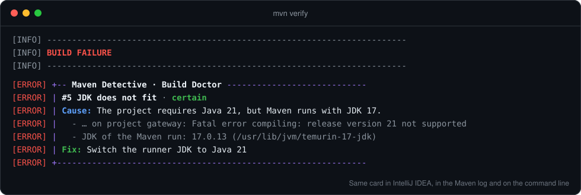
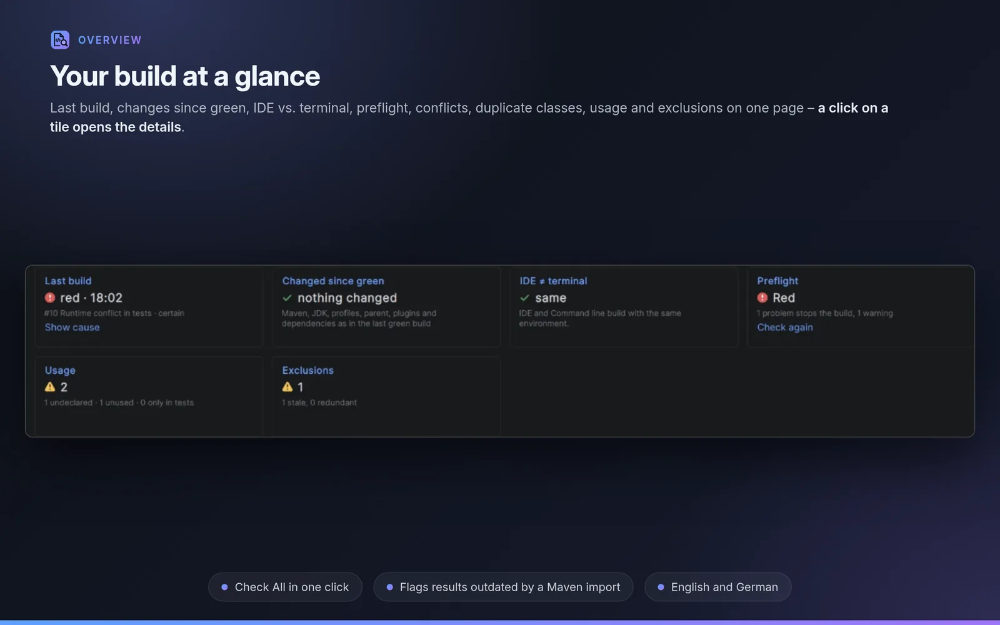
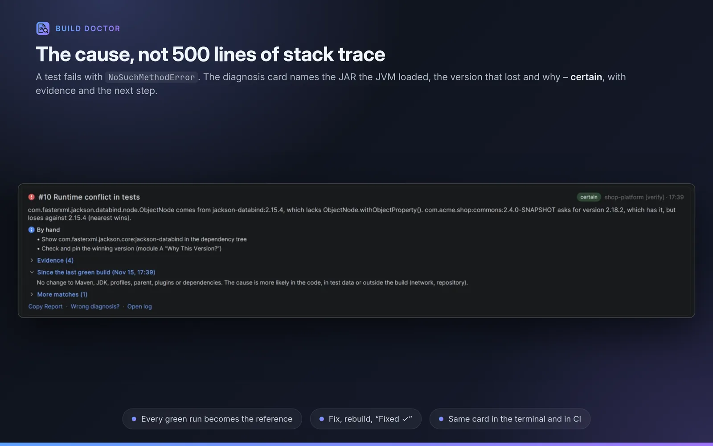
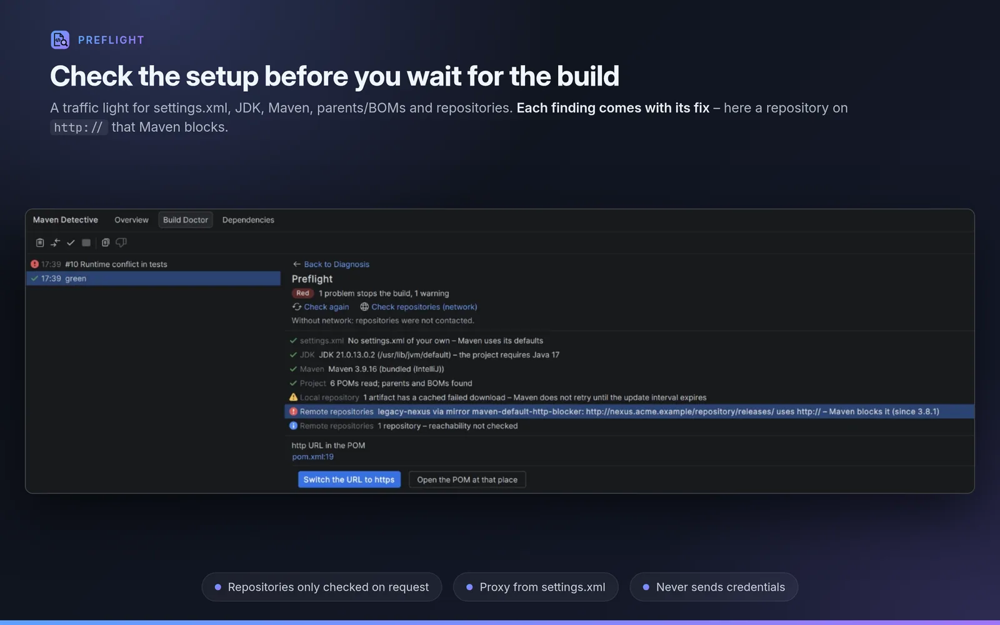
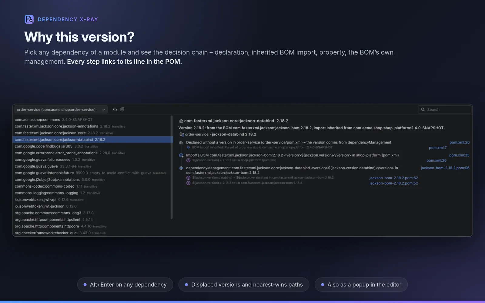
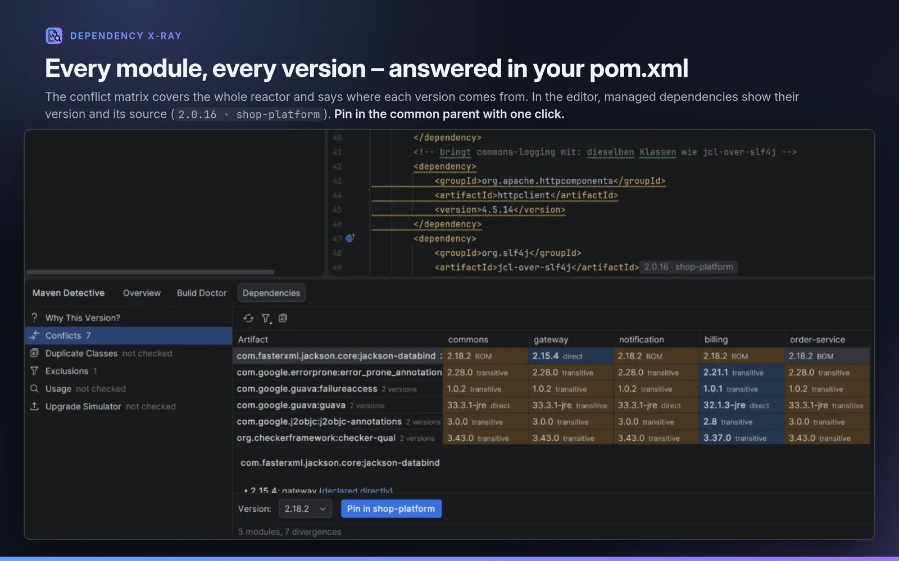
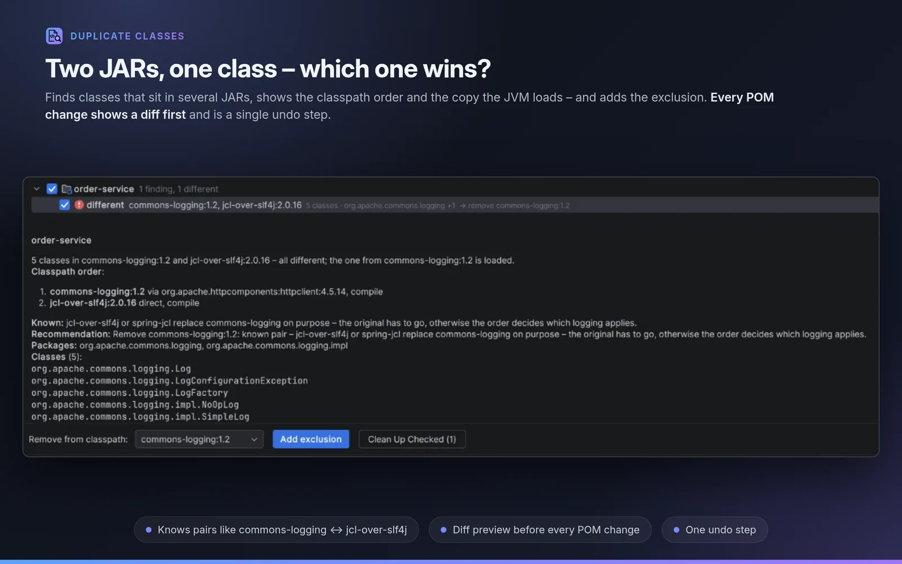
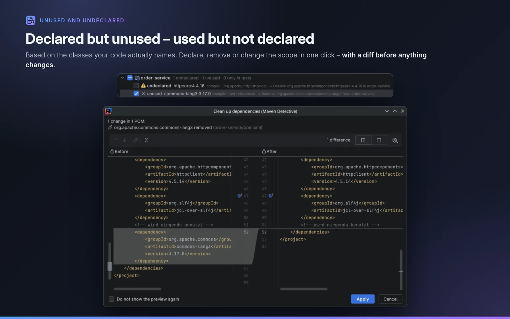
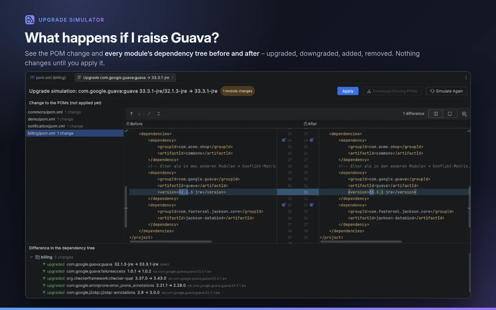

<p align="center">
  
</p>

<p align="center">
  <a href="https://github.com/BitShiftDev/maven-detective/actions/workflows/build.yml"></a>
  <a href="https://github.com/BitShiftDev/maven-detective/releases"></a>
  
  
  
  <a href="LICENSE"></a>
</p>

<p align="center">
  <b>500 lines of Maven log in. One sentence of cause, the evidence and a one-click fix out.</b><br>
  In IntelliJ IDEA, in your terminal and in CI – with the same diagnosis everywhere.
</p>

<p align="center">
  <a href="#installation">Installation</a> ·
  <a href="#build-doctor">Build Doctor</a> ·
  <a href="#dependency-x-ray">Dependency X-ray</a> ·
  <a href="#command-line">Command line</a> ·
  <a href="CHANGELOG.md">Changelog</a>
</p>

---

<p align="center">
  
</p>

## Why Maven Detective?

Every Java developer knows the feeling: `BUILD FAILURE`, followed by a wall of stack traces, download noise and
`-e`/`-X` hints. The real reason is usually one of a dozen classics – a cached failed download, a missing
`<server>` in `settings.xml`, the wrong JDK, a corrupt JAR, a dependency that lost a version fight. Maven Detective
knows these classics, **proves** which one hit you and fixes it.

- **Cause, not symptoms.** A card with one sentence of cause, the log lines and files that prove it, and a confidence level (`certain` / `likely`).
- **One-click fixes.** Rebuild with `-U`, switch the runner JDK, delete broken files, pin a version, add an exclusion – every `pom.xml` change is shown as a diff first and is a single undo step.
- **What changed?** Every green build becomes the reference. When a later build fails, you see exactly what changed since: JDK, Maven, profiles, parent, plugins, dependencies.
- **Dependency X-ray.** *Why This Version?*, conflicts across modules, duplicate classes, dead exclusions, unused and undeclared dependencies – and an upgrade simulator that shows the consequences *before* you touch the POM.
- **Same brain everywhere.** One dependency-free Java 8 core powers the IntelliJ plugin, a Maven core extension for terminal and CI, and a command line tool.
- **Local by default.** Checks only read local files and settings. The network is used only when you explicitly ask for it.
- **English and German** for the user interface and every diagnosis.



## Installation

<a href="https://plugins.jetbrains.com/plugin/36131"></a>

| You want… | Do this |
| --- | --- |
| **The IntelliJ plugin** | *Settings → Plugins → Marketplace* → search for **Maven Detective**, or install it from the [JetBrains Marketplace](https://plugins.jetbrains.com/plugin/36131) (IntelliJ IDEA 2025.3 or newer).<br>Offline: download `maven-detective-<version>.zip` from the [releases](https://github.com/BitShiftDev/maven-detective/releases) and use *Install Plugin from Disk…* |
| **The diagnosis in every `mvn` run** (terminal, CI) | Add the Maven extension – see [Maven extension](#maven-extension). |
| **The command line tool** | Download `maven-detective-cli-<version>.jar` from the [releases](https://github.com/BitShiftDev/maven-detective/releases) and run `java -jar maven-detective-cli-<version>.jar diagnose build.log` (Java 8+). |

Every release ships `SHA256SUMS`. What changed per version: [CHANGELOG.md](CHANGELOG.md).

## Build Doctor

Build Doctor reads the failed run (structured Maven events or the plain log), matches it against its error catalog,
then **verifies** the suspicion against your actual files: the local repository, `settings.xml`, the JDK, the POMs.
Only a confirmed cause is called `certain`.



### What it recognises

| # | Problem | What Build Doctor checks |
| --- | --- | --- |
| 1 | Artifact cannot be resolved | Cached failed downloads (`*.lastUpdated`), offline mode, unknown hosts, unbuilt reactor siblings |
| 2 | Access denied (401/403) | `<server>` entry for the repository id, missing `settings.xml` |
| 3 | HTTP repository blocked | Mirrors and repositories using `http://` (blocked since Maven 3.8.1) |
| 4 | Corrupt JAR in the local repo | Opens the JAR from the local repository |
| 5 | JDK does not fit | Required release vs. the JDK Maven actually runs on, toolchains |
| 6 | Plugin missing or without version | Unknown prefixes, missing plugin versions and declarations |
| 7 | Invalid POM | XML errors with line numbers, parent location, `relativePath` |
| 8 | Reactor problem | Missing child modules, cycles |
| 9 | Compiler error caused by a dependency | Which JAR has the package, scope `test`/`runtime`, `javax` → `jakarta` |
| 10 | Runtime conflict | Which JAR the JVM loads and whether it has the method |
| 11 | Enforcer rule violated | Which rule failed and why |
| 12 | Memory | Maven JVM vs. forked test JVM |
| 13 | Tests failed | Tells a genuine test failure apart from a build problem |
| 14 | EAR/WAR/EJB packaging | Modules missing from the EAR, WAR dependency without `<type>war</type>`, missing descriptors |

Missing a classic? The catalog is plain YAML – [add your own rule](#extend-the-error-catalog).

### Where did that class come from?

For `NoSuchMethodError`, `NoClassDefFoundError` and `package … does not exist`, Build Doctor rebuilds the classpath
of the failed module and reads the class files themselves:

```
Cause (certain): org.x.Util comes from util:1.0, which lacks Util.newMethod(). org.n:mid:1.0 requires
version 2.0, which has it, but loses against 1.0 (nearest wins).
  Loaded:    util:1.0 (compile) – without Util.newMethod() – via org.o:old-user:1.0
  Displaced: util:2.0, requested by org.n:mid:1.0, 1.0 wins – has Util.newMethod()
  Caller org.n.NewUser comes from new-user:1.0
Fix: Pin org.x:util:2.0 in app under dependencyManagement
```

### What changed since the last green build?

```
[ERROR] | Since the last green build (2026-11-12 07:45):
[ERROR] |   - JDK 21.0.4 → 17.0.12
[ERROR] |   - Parent org.springframework.boot:spring-boot-starter-parent 3.4.1 → 3.5.0 (2 modules)
[ERROR] |   - Dependency com.fasterxml.jackson.core:jackson-databind 2.18.2 → 2.19.0 (2 modules)
```

Snapshots live in `~/.maven-detective/snapshots/`, never in your working tree, and record Maven and JDK version,
profiles, mirrors, parents, plugins, version properties and dependencies per module.

In IntelliJ the modules come from the IDE's Maven import, which knows nothing about the `-P`/`-D` of a run
configuration. The IDE therefore reads profiles and `-D` from the run (profile list, goals such as `verify -Pgreen`,
command-line options, runner properties) and records which versions the POMs declare directly under those profiles.
If green and red run used different arguments, the card names them and the changed direct versions, and says that
transitive effects could not be compared – it never claims "no change" in that case.

### More help around the build

- **IDE vs. command line** – *"works in the terminal, fails in IntelliJ"*: a side-by-side table of Maven installation, JDK, `settings.xml`, profiles, VM options and `.mvn/` configuration, with every difference explained.
- **Preflight** – a traffic light *before* you build: `settings.xml`, JDK, Maven, project structure, local repository and, on request, every remote repository (DNS, certificates behind corporate proxies, 401/403, proxy settings) – optionally all through your own Nexus. It can be switched off under *Settings → Tools → Maven Detective*.
- **Log navigator** – modules, plugin steps, the failed module and the *first real* error, with download noise folded away (also in the IDE console).
- **Fix-and-check loop** – after a fix the plugin rebuilds and tells you *Fixed ✓* or shows the next diagnosis.
- **Right in your `pom.xml`** – a banner on the file the last build failed on.



## Dependency X-ray

### Why This Version?

<kbd>Alt</kbd>+<kbd>Enter</kbd> on any `<dependency>` shows the full decision chain – every step links to the POM line
that caused it:

```
Why com.fasterxml.jackson.core:jackson-databind 2.18.2 in com.acme:api:1.0?
Version 2.18.2: from the BOM com.fasterxml.jackson:jackson-bom:2.18.2, imported via org.springframework.boot:spring-boot-dependencies:3.4.1
  1. Declared without a version in api – the version comes from dependencyManagement            → api/pom.xml:21
  2. Imports BOM org.springframework.boot:spring-boot-dependencies:3.4.1 in api                      → api/pom.xml:14
  3. Imports BOM com.fasterxml.jackson:jackson-bom:2.18.2 <version>${jackson-bom.version}</version>  → …/spring-boot-dependencies-3.4.1.pom:2199
       ${jackson-bom.version} = 2.18.2 set in spring-boot-dependencies:3.4.1                         → …/spring-boot-dependencies-3.4.1.pom:79
  4. dependencyManagement: jackson-databind <version>${jackson.version.databind}</version>           → …/jackson-bom-2.18.2.pom:96
Notes
  - ${jackson-bom.version} = 2.17.0 in api has no effect here: the BOM is imported, not inherited,
    and resolves its properties in its own context.
```

It follows Maven's own model-builder rules – inheritance, interpolation, BOM imports, nearest wins – and tells you
when a property you set has *no* effect.



### Conflict matrix

One table for the whole reactor: artifact × module, resolved version in every cell, deviations on top. One click pins
the version in the common parent and names every declaration that would still override it.

```
com.google.guava:guava  – 2 versions
    32.1.3-jre: billing (declared directly)
    33.3.1-jre: api (dependencyManagement), web (transitive, depth 2)
    Suggestion: pin 33.3.1-jre in parent under dependencyManagement
      ! <version>32.1.3-jre</version> in billing overrides dependencyManagement – remove it after pinning  → billing/pom.xml:31
```



### Duplicate classes

Classes that sit in more than one JAR – also under different coordinates (`commons-logging` next to `jcl-over-slf4j`,
`javax.xml.bind` next to `jakarta.xml.bind-api` 2.x). Shows which copy wins, whether the contents differ, and inserts the
exclusion that removes the redundant JAR.



### Exclusion hygiene

After an upgrade, many `<exclusion>`s exclude nothing anymore. An inspection greys them out right in `pom.xml`;
<kbd>Alt</kbd>+<kbd>Enter</kbd> removes them.

### Unused and undeclared dependencies

Based on the classes your sources actually name (resolved through the IDE's code index): dependencies you use but only get
transitively, declared dependencies nobody uses, and `compile` dependencies only tests need – with one-click *declare*,
*remove* and *change scope*. JDBC drivers, logging backends and JARs that register services are never flagged as
"surely unused".



### Upgrade simulator

*"What happens if I raise X to version Y?"* – answered **before** you change anything:

```
Upgrade simulation: org.apache.maven:maven-model 3.1.1 → 3.2.5 (POMs unchanged)

Change to the POMs:
  1. Set property ${maven.version} in demo to 3.2.5 – everything that uses it changes too  → pom.xml:7

Module demo: 5 upgraded
  ↑ org.apache.maven:maven-model 3.1.1 → 3.2.5 (direct)
  ↑ org.apache.maven:maven-plugin-api 3.1.1 → 3.2.5 (direct)
  ↑ org.codehaus.plexus:plexus-utils 3.0.15 → 3.0.20 via org.apache.maven:maven-model:3.2.5
  ↑ org.apache.maven:maven-artifact 3.1.1 → 3.2.5 via org.apache.maven:maven-plugin-api:3.2.5
  ↑ org.eclipse.sisu:org.eclipse.sisu.plexus 0.0.0.M5 → 0.3.0.M1 via …
```

The simulator finds the place that sets the version today – property, BOM import, parent, direct declaration or
`dependencyManagement` – applies the change in memory, rebuilds every module's tree and shows what goes up (`↑`), down
(`↓`), appears (`+`) or disappears (`−`), plus new conflicts. One more click applies exactly the simulated change.



### Answers right in your `pom.xml`

- `2.18.2 · jackson-bom` as an inlay behind every dependency without a version
- `3 modules · 2 versions` above dependencies whose version differs across modules
- a gutter icon where a dependency brings duplicate classes or loses a higher requested version
- *Why This Version?* and *Simulate Upgrade…* on right-click – also in the Maven tool window and under *External Libraries*

> Maven Detective complements Maven Helper and IntelliJ's Dependency Analyzer: they show you the facts,
> Maven Detective shows you the cause and the fix.

## Maven extension

Put the diagnosis card into **every** Maven run – on your machine and in CI – without changing the build itself.

[](https://central.sonatype.com/artifact/io.github.bitshiftdev.mavendetective/maven-detective-extension)

**Per project** (everyone on the team and CI get it), in `.mvn/extensions.xml` – replace `VERSION` with the latest
version from the badge above:

```xml
<extensions>
  <extension>
    <groupId>io.github.bitshiftdev.mavendetective</groupId>
    <artifactId>maven-detective-extension</artifactId>
    <version>VERSION</version>
  </extension>
</extensions>
```

**Without touching the project** (JAR from the [releases](https://github.com/BitShiftDev/maven-detective/releases)):

```bash
mvn -Dmaven.ext.class.path=/path/to/maven-detective-extension-<version>.jar verify
```

**For all your builds:** copy the JAR to `$MAVEN_HOME/lib/ext/`.

The extension has no dependencies, runs on Maven 3.8 or newer with Java 8 or newer (Maven 4 needs Java 17), never
changes the outcome of the build and swallows its own errors. CI tests it against every Maven version in
[`fixtures/maven-versions.txt`](fixtures/maven-versions.txt); Maven 4 release candidates are tested, but not yet
supported officially.

| Option | Effect |
| --- | --- |
| `-DmavenDetective.language=en\|de` | Language of the card (also env `MAVEN_DETECTIVE_LANGUAGE`; default: system language) |
| `-DmavenDetective.report=false` | No card in the log |
| `-DmavenDetective.snapshots=false` | No snapshots for *What changed?* |
| `-DmavenDetective.home=…` | Where snapshots live (also env `MAVEN_DETECTIVE_HOME`; default `~/.maven-detective`) |
| `-DmavenDetective.eventsFile=target/md-events.jsonl` | Also write structured build events as JSON lines |

**No card and no snapshot at all?** Maven silently ignores a `maven.ext.class.path` that does not point to a JAR. Run
with `-X` and check the line `Included …` under `Populating class realm maven.ext`: it must show only the JAR path.
A common cause is passing all options as one shell argument (e.g. `E="-Dmaven.ext.class.path=… -DmavenDetective.home=…"`
and `mvn verify $E` in zsh, which does not split variables) – Maven then reads the whole string as the path.

## Command line

```bash
# Explain a failed build – from a file, from CI, or straight from a pipe
java -jar maven-detective-cli.jar diagnose build.log --project .
mvn verify 2>&1 | java -jar maven-detective-cli.jar diagnose -

# Paste-ready Markdown for a ticket or chat
java -jar maven-detective-cli.jar diagnose build.log --markdown
```

| Command | What it answers |
| --- | --- |
| `diagnose <log\|->` | Why did this build fail? (`--markdown`, `--catalog extra.yaml`) |
| `changes` | What changed since the last green build? |
| `preflight` | Can this build run at all? (`--network` also checks the repositories, `--nexus URL` routes them through your own repository manager) |
| `outline <log\|->` | Modules, failed step, first real error (`--strip` drops download noise) |
| `why <g:a>` | Why this version? |
| `matrix` | Which module uses which version? (`--pin <g:a>` pins it in the parent) |
| `duplicates` | Which classes live in more than one JAR? (`--exclude` adds exclusions) |
| `exclusions` | Which exclusions exclude nothing? (`--remove`) |
| `analyze` | Used but undeclared, declared but unused (`--declare`, `--remove`) |
| `upgrade <g:a:v\|prop=value>` | What happens if I upgrade? (`--fetch`, `--manage`, `--apply`) |
| `evaluate <dir>` | Run the diagnosis over a folder of logs and report the hit rate |
| `validate-catalog <file>` | Check a custom rule file |

All commands accept `--project <dir>` and `--lang en|de`. Dependency commands take the resolved tree via
`--tree tree.txt` (from `mvn dependency:tree -Dverbose`) and otherwise rebuild it from the POMs in your local
repository. Exit code `3` means "findings" – handy as a CI gate; `2` means the command line itself is wrong
(unknown command or option, missing value). Options can be written as `--option value` or `--option=value`.

## Extend the error catalog

Rules live in a YAML catalog. A new rule needs no Java code as long as it reuses existing checks and fix types:

```yaml
  - id: my-new-rule
    number: 15
    category: Kurzer Titel der Karte     # German text …
    category_en: 'Short card title'      # … and its English counterpart
    priority: 60                         # higher wins when several rules match
    patterns:
      - 'Regex with a (?<artifact>named group)'
    cause: 'Ursache in einem Satz mit {artifact|Ersatztext}.'
    cause_en: 'Cause in one sentence with {artifact|fallback text}.'
    checks: [last-updated-files]
    fix:
      type: rebuild
      label: 'Mit -U neu bauen'
      label_en: 'Rebuild with -U'
      params:
        args: '-U'
```

Load it with `diagnose … --catalog my-rules.yaml`, validate it with `validate-catalog my-rules.yaml`.
The built-in catalog is [`build-doctor-v1.yaml`](core/src/main/resources/io/github/bitshiftdev/mavendetective/core/catalog/build-doctor-v1.yaml).

Available checks: `offline-mode`, `network-failure`, `last-updated-files`, `reactor-sibling`, `requested-repository`,
`server-id`, `http-repository`, `corrupt-jar`, `pom-location`, `parent-relative-path`, `child-module`, `plugin-prefix`,
`plugin-version`, `plugin-declaration`, `ear-module`, `ee-namespace`, `jdk-version`, `source-location`, `enforcer-rule`,
`memory-settings`, `class-origin`, `class-location`.

## How it works

```
 Maven events / log ──▶ error lines ──▶ catalog rules match ──▶ checks verify against your files ──▶ card + quick fix
                                                                 (local repo, settings.xml, JDK, POMs)
```

A diagnosis is `certain` only when the pattern is unambiguous or a check confirmed the cause on a file, a setting or the
JDK. The core has no runtime dependencies and targets Java 8, so the very same code runs inside Maven's class loader,
inside IntelliJ and on the command line.

| Module | Contents |
| --- | --- |
| [`core/`](core) | Log parser, rule engine, checks, fixes, snapshots, dependency analysis, CLI |
| [`maven-extension/`](maven-extension) | Maven `EventSpy` that prints the card into the Maven log |
| [`intellij-plugin/`](intellij-plugin) | Tool window, diagnosis card, inspections, inlays, quick fixes |
| [`fixtures/`](fixtures) | One Maven project per error category that triggers the failure on purpose |

## Building from source

Requires JDK 21 (core and extension are still compiled to Java 8 bytecode).

```bash
./gradlew :core:test                    # unit tests incl. the error catalog
./gradlew :intellij-plugin:runIde       # start IntelliJ IDEA with the plugin
./gradlew :maven-extension:fixtureTest  # trigger every fixture with a real Maven (mvn on PATH)
```

## Contributing

Misdiagnosed a build? That is the most valuable report you can send: open a
[*Wrong diagnosis* issue](https://github.com/BitShiftDev/maven-detective/issues/new/choose) with an anonymised log
excerpt around `BUILD FAILURE` and what the real cause was. The plugin's *Wrong diagnosis?* link saves the log for you.

Bug reports, new rules and pull requests are welcome in English or German – see [CONTRIBUTING.md](CONTRIBUTING.md).
Please report security issues privately as described in [SECURITY.md](SECURITY.md).

## License

[Apache License 2.0](LICENSE)
